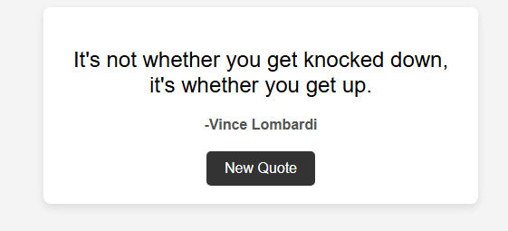

# Random Quote Generator

A simple JavaScript project that displays a random inspirational quote everytime you click the button.
Built using HTML, CSS and JavaScript.

##  🚀 Features
- Displays a random Quote from a local collection 
- smooth button hover effect/ animation 
- clean, minimal UI
- Easily expandable with more quotes 

## 🛠️ Technologies Used
- **HTML** - structure 
- **CSS**- Styling and animations
-**JavaScript**- logic & interactivity

## 📸 Screenshot



##  📂 How to Run Locally
1. Clone the repository:
```bash 
git clone https://github.com/CodewithDivine-commits/random-quote-generator.git

🌟 Future Improvements
. Add more quotes
. Fetch quotes from an API 
. Add copy-to-clipboard or share Twitter (X) button.

👨‍💻 Author: AGU Divinefavour Chidera
